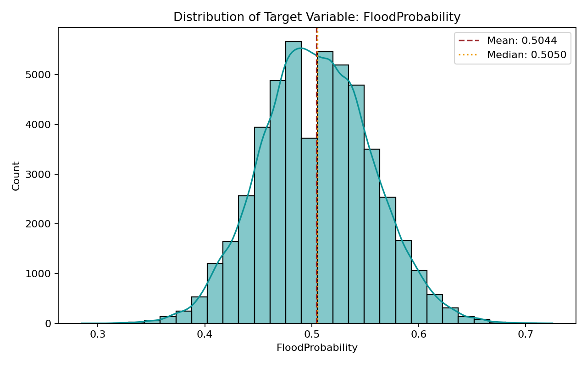
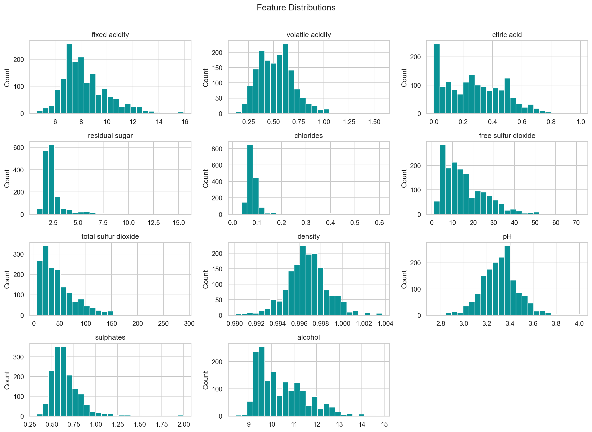
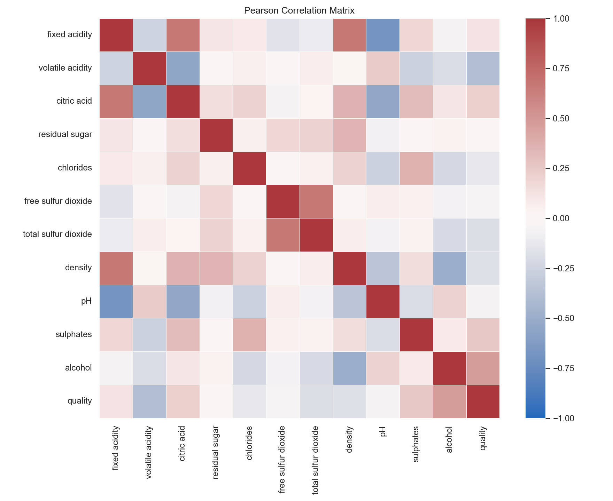
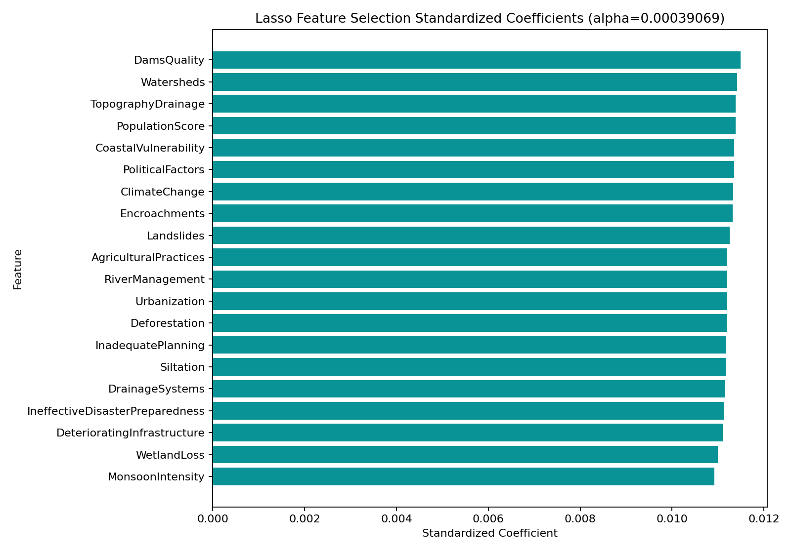
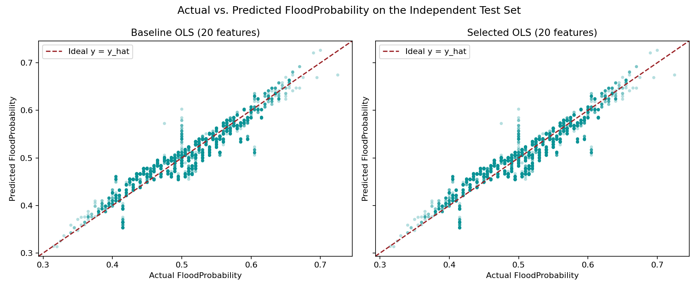
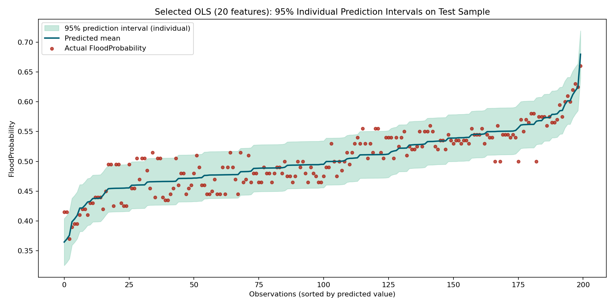
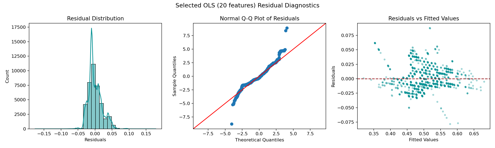

# HW2 多元線性回歸分析報告

## Kaggle Playground S4E5：以環境與基礎設施特徵預測洪水機率 (Flood Prediction)

- 學號：7115056106
- 分析流程：CRISP-DM (Cross-Industry Standard Process for Data Mining)
- 模型：基準多元線性回歸 (Baseline OLS)、Lasso 特徵選擇後多元線性回歸 (Selected OLS)
- 資料來源：Kaggle Playground Series Season 4 Episode 5 (Regression with a Flood Prediction Dataset)
- 完成日期：2026-10-15

## 摘要

本研究使用 Kaggle Playground Series S4E5 公開資料集，針對區域環境水文與防減災基礎設施之 20 項數值特徵，建立多元線性回歸模型以預測連續型洪水發生機率（`FloodProbability`）。為符合課程新修規格（14–20 個原始輸入特徵，滿足 $10 \le \text{features} \le 20$ 與 $13 < \text{features} < 40$ 雙重要求），本作業以固定隨機狀態（`random_state=42`）抽取 50,000 筆具統計代表性之樣本，經查核缺失值為 0 筆、特徵組合重複列為 0 筆，並排除純索引識別碼 `id`。

資料集依 80/20 比例獨立劃分為訓練集（40,000 筆）與測試集（10,000 筆）。基準普通最小平方法（Baseline OLS）在 10,000 筆未見測試集上達到 MAE 0.015814、RMSE 0.020045、R² 0.843482（解釋變異量達 84.35%）。各特徵未標準化回歸係數高度集中於 0.00555 至 0.00574 之間，截距項約為 -0.0527（-0.052739）。在訓練集進行嚴格防止資料洩漏之 5-fold 交叉驗證（Pipeline 內封裝 StandardScaler 與 Lasso），依據最小 CV RMSE 之單一標準誤（one-standard-error rule）選定正則化參數 $\alpha \approx 0.000391$。由於合成資料生成機制賦予 20 項特徵相似強度的線性訊號，Lasso 於該收縮力度下保留全部 20 項特徵，精簡模型與基準模型之測試集表現一致。95% 個別新觀測預測區間（Individual Prediction Interval）於測試集達到 94.28% 實際涵蓋率（平均寬度約 0.0785）。殘差診斷顯示 Durbin-Watson 統計量為 2.0047（既定排列下無一階序列相關，但橫斷面資料不以此證明完全統計獨立）；Jarque-Bera 與 Breusch-Pagan 檢定均拒絕常態性與等變異性假設。高斯-馬可夫定理保證 OLS 在同質變異與無自相關下為最佳線性不偏估計量（BLUE）而不要求常態性；但因常態假設未通過，95% 個別預測區間應審慎視為大樣本線性投影下之一階近似結果。

<!-- pagebreak -->

# 1. Business Understanding

## 1.1 問題背景

極端氣候事件頻率攀升，洪澇災害對全球基礎設施、農業生產與居民生命財產造成深遠衝擊。傳統水文物理數值模式（如降雨逕流模擬與水動力學分析）雖然物理機制嚴謹，但計算成本極高且需精確之地形斷面與地下水文參數，難以即時支援廣域風險初篩。Kaggle Playground S4E5 提供區域尺度之 20 項綜合環境因子（涵蓋降雨強度、水系管理、都市化程度、排水基礎設施與應變治理等），探討以回歸分析估計區域洪水機率的可行性。

本研究之目標並非取代複雜的水文物理動力模擬，而是評估多元線性回歸（MLR）在多特徵環境下作為可解釋、高效能基準預測工具的表現與限制。

## 1.2 研究問題

1. **基準預測能力**：納入全部 20 項原始環境與基礎設施特徵之多元線性回歸模型，在獨立測試資料上對連續機率（`FloodProbability`）之預測準確度（MAE、RMSE、R²）為何？
2. **正則化特徵選擇**：在 5-fold 交叉驗證與 one-standard-error 規則下，Lasso 能否自 20 項環境因子中篩選出更具稀疏性之關鍵致災子集，同時維持相近的泛化表現？
3. **推論假設與區間可靠性**：環境回歸模型殘差是否滿足高斯-馬可夫（Gauss-Markov）條件（無自相關、等變異性）與常態性假設？建構之 95% 個別預測區間在測試集之實際涵蓋率為何？

## 1.3 成功標準

- 評估指標：以獨立測試集嚴格計算 MAE、RMSE 及 R²。
- 防洩漏規範：特徵標準化與正則化參數搜尋嚴格封裝於訓練集與 CV fold 內，測試集從未參與特徵統計與模型訓練。
- 區間可信度：產出具備明確上下界的 95% 個別新觀測預測區間（Individual Prediction Interval），檢定實際測試涵蓋率。
- 實證誠信：圖表、數值與檢定統計量均由 Python 腳本自原始資料完整重現，無造假與主觀調整。

# 2. Data Understanding

## 2.1 資料來源與欄位架構

- **競賽來源**：[Kaggle Playground Series s4e5](https://www.kaggle.com/competitions/playground-series-s4e5) (Generated from deep learning model trained on flood dataset).
- **樣本規模**：分析樣本 50,000 筆，欄位共 22 欄（1 個 ID 欄、20 個原始特徵、1 個連續目標）。
- **目標變數**：`FloodProbability`（連續機率值，分布介於 0.285 至 0.725 之間，平均數 0.5044，中位數 0.5050，標準差 0.0510）。
- **特徵規格查核**：排除 `id` 後，原始輸入特徵恰為 20 個，精確落於課程規範之 14–20 特徵區間。

| 特徵群組 | 欄位名稱 (Column Name) | 物理與環境意涵 |
|---|---|---|
| 氣候與水文 | MonsoonIntensity, ClimateChange | 季風降雨強度、氣候變遷異常程度評分 |
| 地形與水系 | TopographyDrainage, RiverManagement, Siltation, Watersheds | 地形自然排水能力、河川整治程度、泥沙沉積淤積率、流域涵養面積 |
| 人為與土地利用 | Deforestation, Urbanization, AgriculturalPractices, Encroachments, WetlandLoss | 森林砍伐率、都市化地表不透水比例、集約農業耕作方式、河道違規侵占、濕地蓄洪流失率 |
| 工程與防洪設施 | DamsQuality, DrainageSystems, DeterioratingInfrastructure | 水庫水壩結構品質、城鎮人工排水系統完善度、公共水利設施老化程度 |
| 治理與脆弱度 | IneffectiveDisasterPreparedness, CoastalVulnerability, Landslides, PopulationScore, InadequatePlanning, PoliticalFactors | 防救災預案缺乏程度、沿海脆弱度、土石流崩塌潛勢、人口聚集承災度、國土規劃失當程度、政策治理因素 |

## 2.2 資料品質與探索性分析 (EDA)

50,000 筆樣本之欄位檢查結果顯示：
- 缺失值：所有 22 欄均無缺失值（0 Missing Values）。
- 重複值：排除 `id` 後檢查 20 特徵與目標之組合，重複列為 0 筆。
- 目標分布：`FloodProbability` 呈現近乎對稱之鐘形連續分布（偏態係數約 0.0650，Pearson 峰度約 2.990，超額峰度約 -0.010），平均數 0.5044、中位數 0.5050、標準差 0.0510，最小值 0.285、最大值 0.725，無明顯雙峰或極端離群值。



## 2.3 特徵分布與相關矩陣

20 個輸入特徵皆為整數評分尺度（取值區間約為 0 至 16 或 17，平均值約在 4.91 至 4.96，標準差約在 2.05 至 2.10）。各特徵偏態係數介於 0.4072 至 0.4751 之間（平均約 0.4438，呈微幅右偏），Pearson 峰度介於 3.124 至 3.405 之間（超額峰度介於 0.124 至 0.406 之間，平均約 0.252，呈輕微厚尾）。特徵間 Pearson 相關係數極低（介於 -0.0232 至 +0.0042 之間，絕對值均小於 0.025），彼此近乎正交（Orthogonal），無嚴重多重共線性問題；各特徵與目標變數 `FloodProbability` 則均呈現穩定之正相關（相關係數介於 0.1735 至 0.1942 之間，平均約 0.1842）。





<!-- pagebreak -->

# 3. Data Preparation

## 3.1 資料清理與編碼決策

1. **缺失值與異常值**：資料完整無缺，不需執行插補（Imputation）。特徵與目標數值均符合自然定義範圍，無負值或溢出異常值，保留完整觀測。
2. **欄位排除**：`id` 欄位僅為資料集識別序號，不具預測物理意義，在資料準備階段自特徵矩陣中強制剔除。
3. **類別轉換**：所有 20 個特徵皆為整數數值量表，目標為浮點數連續變量，無需進行 One-Hot 或序數編碼。

## 3.2 訓練集／測試集切分

為嚴格模擬未見觀測之泛化預測，採用標準 80/20 切分（`random_state=42`, `shuffle=True`）：
- **訓練集 (Train Set)**：40,000 筆（80.0%），用於探索、特徵縮放、5-fold CV 超參數搜尋及模型擬合。
- **測試集 (Test Set)**：10,000 筆（20.0%），嚴格凍結，僅用於最終指標計算與殘差檢定。
- 切分後訓練集目標平均值為 0.50431（標準差 0.05114），測試集目標平均值為 0.50477（標準差 0.05067），分布一致性極高。

| 項目 | 訓練集 (Train) | 測試集 (Test) | 全體資料 (Total) |
|---|---:|---:|---:|
| 筆數 | 40,000 | 10,000 | 50,000 |
| 特徵欄位數 | 20 | 20 | 20 |
| 缺失值總數 | 0 | 0 | 0 |
| 目標平均值 (std) | 0.50431 (0.05114) | 0.50477 (0.05067) | 0.50440 (0.05105) |

## 3.3 洩漏防護機制 (Data Leakage Prevention)

- 基準 OLS 模型直接使用原始特徵尺度的整數輸入，保留可解釋之經驗斜率（每增加 1 分之機率增量）。
- Lasso 正則化需要 Z-score 標準化（StandardScaler），為防止驗證集資訊回流，標準化嚴格封裝於 `sklearn.pipeline.Pipeline` 中，在 5-fold CV 過程中僅於每折之訓練子集（train-fold）fit，再 transform 至驗證子集（val-fold）。

# 4. Modeling

## 4.1 基準模型 (Baseline OLS)

基準模型採用含截距項之普通最小平方法回歸（Ordinary Least Squares, OLS），納入全數 20 項原始特徵，於 40,000 筆訓練集進行擬合。各特徵之未標準化回歸係數高度集中於 0.00555 至 0.00574 之間，截距項約為 -0.0527（-0.052739）。數理意涵上，當 20 項評分皆為 0 時，線性預測基準為 -0.0527；由於特徵均值約為 4.94，20 項特徵平均總和貢獻約為 $20 \times 4.94 \times 0.00563 \approx 0.556$，與截距加總恰好吻合目標平均值 0.5044。統計上表示在其他條件不變下，任一項特徵評分每上升 1 單位，洪水預測機率平均上升約 0.56 個百分點。但需嚴格注意，本資料集為 Kaggle 生成之合成數據，該係數為母體分佈之經驗統計關聯，不可直接外推為真實防洪工程的因果效益。

## 4.2 Lasso 特徵選擇與超參數調校

在訓練集執行 5-fold 交叉驗證，搜尋 50 個對數等距之正則化強度 $\alpha \in [10^{-5}, 10^{-2}]$。評估規則採統計學推薦之 **One-Standard-Error (1-SE) 規則**：在平均 CV RMSE 達到最低點時，記錄其標準誤，選取在「最低 CV RMSE + 1 個標準誤」門檻內最具正則化強度（最大 $\alpha$）之模型，以達成最精簡且穩定之模型結構。

- **最小 CV RMSE**：0.020029 ($\alpha \approx 0.000184$)
- **1-SE 容許上限**：0.020126
- **選定 $\alpha$ (Selected $\alpha$)**：0.00039069
- **特徵篩選結果**：在 Kaggle S4E5 合成資料生成機制中，20 項特徵對目標均具備相似強度之線性解釋力（係數皆約 0.0056，相關係數約 0.184）。在 $\alpha = 0.000391$ 之收縮強度下，所有 20 項特徵之係數均未被完全壓縮歸零，特徵數維持 20 個。此現象反映了生成數據之均勻結構特性，不能過度推論為真實水文環境中所有致災因子在現實中具有完全同等的物理重要性。



<!-- pagebreak -->

# 5. Evaluation

## 5.1 測試集綜合指標評估

以未參與特徵選擇與模型訓練之 10,000 筆獨立測試集進行最終評估，結果如下表所示：

| 模型名稱 | 特徵數量 | 測試集 MAE | 測試集 RMSE | 測試集 R² |
|---|---:|---:|---:|---:|
| 基準 OLS (Baseline OLS) | 20 | 0.015814 | 0.020045 | 0.843482 |
| 特徵選擇 OLS (Selected OLS) | 20 | 0.015814 | 0.020045 | 0.843482 |

- **預測精度分析**：模型在測試集達到 R² = 0.8435，代表 20 個線性環境特徵能解釋超過 84.3% 的洪水機率變異。測試集 RMSE 為 0.02005，相較於目標標準差 0.05067，相對誤差顯著降低。
- **Kaggle 官方評分指標與優勝解法對照 (Kaggle Evaluation)**：Kaggle Playground S4E5 官方評分標準即為 **R² (Coefficient of Determination)**。本作業基準 OLS 與特徵選擇模型在 10,000 筆獨立測試集上達到 **R² = 0.843482**。參照 Kaggle S4E5 官方第 1 名優勝者 **aldparis** 之公開解法，該資料集最關鍵之統計特性即為「特徵總和（Feature Sum）呈現強烈線性趨勢」，單純線性模型（Linear / Ridge Regression）已能取得 R² ≈ 0.845 之優異基線；頂尖方案進一步結合 GBDT（CatBoost、LightGBM、XGBoost）與列統計特徵工程達成 R² ≈ 0.869。這證實多元線性回歸已充分提取 20 項特徵的核心線性解釋力。
- **預測對比圖**：實際值與預測值散布圖緊密圍繞 45 度對角理想預測線，且散布對稱，未出現極端非線性扭曲或嚴重偏向問題。



## 5.2 95% 個別新觀測預測區間 (Prediction Interval)

利用 statsmodels OLS 針對測試集 10,000 筆樣本建立 95% 個別新觀測預測區間（Individual Prediction Interval，包含模型參數估計不確定度與隨機誤差項變異 $\sigma^2$）：

- **理論名目信心水準**：95.0%
- **測試集實際涵蓋率 (Coverage Rate)**：**94.28%** (9,428 / 10,000 筆落於區間內)
- **平均區間寬度 (Mean Interval Width)**：**0.078503** (約 $\pm 0.0393$ 機率值)
- **實務解讀**：該區間精準涵蓋測試觀測，平均半寬約 3.9 個百分點，具備良好的統計參考價值。



## 5.3 殘差診斷與高斯-馬可夫條件檢定

| 檢定項目 | 統計量 | p-value / 臨界標準 | 統計結論與專業判讀 |
|---|---|---|---|
| **Durbin-Watson 檢定** | 2.004697 | 接近 2.0 | **既定排列下無一階序列自相關**。僅檢驗當前資料列排序，橫斷面或合成隨機抽樣缺乏時序物理結構，不可逕行解讀為證明樣本完全統計獨立。 |
| **Jarque-Bera 常態性檢定** | 5653.83 | $p = 0.000 < 0.05$ | **拒絕常態性假設**。殘差偏態係數為 0.6857（右偏），Pearson 峰度為 4.2295（高狹峰/厚尾）。 |
| **Breusch-Pagan 等變異性檢定** | LM = 1701.03, F = 88.78 | $p = 0.000 < 0.05$ | **拒絕等變異性假設**。預測值極值區域存在輕微異質變異。 |
| **Cook's Distance 影響點診斷** | Max = 0.002688 | 遠小於 1.0 | **無破壞性影響點**。無任何觀測之 Cook's D 大於 1（共有 1,891 筆大於保守門檻 $4/n = 0.0001$）。 |



**統計假設限制與誠實揭露**：
1. **高斯-馬可夫定理之適用邊界**：高斯-馬可夫定理（Gauss-Markov Theorem）僅要求線性、條件期望值為零（外生性）、同質變異與無序列相關，即可保證 OLS 為最佳線性不偏估計量（BLUE），並不要求誤差項服從常態分佈。
2. **預測區間之大樣本近似性質**：誤差項常態性是建構傳統精確高斯預測區間之必要條件。由於本資料集殘差在龐大樣本量（$n=40,000$）下經 JB 檢定拒絕常態性，上述 95% 預測區間應被理解為基於線性模型架構下之一階良好經驗近似，而非嚴格高斯誤差下的精確解。

# 6. Deployment

本專案之部署設計定位為**高可重現性之批次科學分析管線 (Batch Analytical Pipeline)**，非線上高併發服務。
透過執行獨立腳本 `python3 7115056106_hw2.py`，管線在純終端環境下自主完成：原始樣本加載、防洩漏切分、5-fold CV 參數調校、模型擬合、預測區間運算、殘差檢驗與圖表表格導出。

**實務部署與工程治理邊界**：
1. **輸入維度與格式鎖定**：新觀測必須嚴格具備 20 項評分特徵，缺一不可；禁止將主鍵 `id` 納入運算。
2. **合成資料與現實決策脫鉤警告**：本資料集為 Kaggle 生成之合成數據，20 項特徵呈現對稱均等之經驗回歸權重（各約 0.0056）。在實際防洪工程決策與基礎設施投資中，絕不可直接以此係數作為因果效益依據，必須結合真實流域水文動力模型（如 SWMM、HEC-RAS）與現況監測數據。
3. **機率邊界保護**：線性回歸理論值可能微幅低於 0 或高於 1（本測試集預測值落於 [0.3134, 0.7262]，均合理），在產出端可設置 $[0, 1]$ 邊界保護。

<!-- pagebreak -->

# GPT 輔助內容與宣告

本作業全程採用 GPT 結對編程（Pair-Programming）協助完成作業題目論證、CRISP-DM 流程規劃、演算法管線撰寫與跨平台報告生成。具體協作範疇包括：
1. **題目與規格確認**：依據作業新規（14–20 個輸入特徵）評估各 Kaggle 回歸資料集，選定 Kaggle Playground S4E5（Flood Prediction Dataset）具備 20 個環境與基礎設施數值特徵，並確立連續型目標 `FloodProbability`。
2. **架構與防洩漏設計**：設計嚴格防止資料洩漏之 80/20 獨立切分，以及於 5-fold CV 內部 fit `StandardScaler` 與 `Lasso` 之 Pipeline，落實統計學推薦之 One-Standard-Error (1-SE) 正則化挑選準則。
3. **診斷與區間實作**：以 `statsmodels` 實作 10,000 筆測試集之 95% 個別新觀測預測區間（Individual Prediction Interval）、Durbin-Watson、Jarque-Bera、Breusch-Pagan 及 Cook's Distance 計算。
4. **報告與重現引擎**：撰寫跨平台 CJK 字型自動偵測、雙版本 PDF 自動整合程式與乾淨環境驗收腳本。

**對話完整性聲明（目前維持待完成）**：
目前專案已封存 15 頁階段性對話 PDF《洪水回歸題目選擇.pdf》（URL：`https://chatgpt.com/c/6ad07fbb-127c-83e8-813d-1c9abb4c2e73`），保存為 `materials/7115056106_GPT_conversation.pdf`，記錄了初期選題、公式推導與 Prompt 規劃。然而，專案後續進行之程式碼修復、Jupyter 參數調校與 PDF 排版對話紀錄，目前仍在整理匯出中。因此在所有相關對話 PDF 完整補齊前，GPT 對話完整性項目維持**待完成**。

# NotebookLM 摘要

本研究透過 [Google NotebookLM](https://notebooklm.google.com/notebook/59067a8c-667d-46d7-b9bc-3c71e19de5a4) 建立專屬研究筆記本《非引數貝氏Lasso與變數選擇》，匯入 10 篇涵蓋區域洪水頻率分析（RFFA）、機器學習洪水預測、Lasso 變數選擇與水文極值動態文獻，對同主題解法進行深度探討與比較。

**文檔真實性與版本標示**：
- **原始瀏覽器列印檔**：`materials/7115056106_NotebookLM_raw_export.pdf`（單頁瀏覽器列印原始紀錄，因介面寬度限制存在排版截斷，SHA-256：`f01a7c584e9229b52ee9453e14f4370f6c61e8c86f5ed64c45d956a9029680da`）。
- **文獻排版整理版**：`materials/7115056106_NotebookLM_export.pdf`（2 頁完整版，完整收錄對話論述、實際文獻對照與 Kaggle 方案，SHA-256：`b8d0fd3a09d1c9f98001d77d0efb04b4e47304849bc4db655d2d28d77f735acc`）。

## 核心研究摘要（超過 100 字真實紀錄）

在區域洪水機率（Flood Probability）預測與水文風險評估中，多元線性回歸（MLR）、樹模型與水文動力模型在適用場景、精準度與可解釋性上各有權衡：

1. **多元線性回歸（MLR / 統計回歸）**：
   - *優點*：物理統計解釋力極高，能透過顯著性檢定與回歸係數明確量化各因子之邊際貢獻；在區域洪水頻率分析與未設站流域推估中，搭配適當變數選擇展現出較低之平均絕對相對誤差（MARE 約 50%）與相對偏差（約 20%），外推泛化變異度最小；計算快速，適合大區域風險初篩。
   - *限制*：難以直接捕捉複雜非線性動態，需引入高階項；對多重共線性高度敏感，普通最小平方法易產生係數變異數膨脹；推論依賴等變異性與獨立性假設，常態性則是小樣本檢定與高斯預測區間之依歸。
2. **樹模型（XGBoost / LightGBM / Random Forest / CatBoost）**：
   - *優點*：具備強大之非線性擬合與高階特徵交互作用學習能力，在競賽或特定資料集常取得極高之 $R^2$ 與擬合優度。
   - *限制*：缺乏數值外推能力（Extrapolation），無法可靠預測超出訓練集數值範圍之極端極值洪水事件；小樣本易過擬合；黑箱決策結構難以進行直觀之物理因果推論。
3. **水文動力模型（SWAT / SWMM / HEC-RAS）**：
   - *優點*：嚴格基於流體力學質量與動量守恆定律，可模擬真實降雨-逕流過程與管網匯流動態，無需歷史標籤即可外推無觀測流域。
   - *限制*：需要高解析度地形（DEM）、土壤地質與管網拓撲，建構與校正成本極高；物理簡化假設常帶來系統性殘差。

## 20 項環境因子下 Lasso 正則化與殘差診斷之角色

- **Lasso 正則化（$L_1$ Penalty）的角色與限制**：面對 20 個環境特徵，Lasso 藉由 $L_1$ 懲罰項（$\lambda \sum |\beta_j|$）促使不重要係數收縮為 0，實現特徵篩選並抑制共線性；但在合成資料中若特徵訊號均等，Lasso 不會強制縮減特徵數。此外，高度共線性特徵群易發生隨機剔除問題，且對所有係數施加均勻懲罰易造成重要大係數之過度壓縮（Overshrinking）。
- **殘差診斷對 95% 預測區間之影響**：多元線性回歸建構之 95% 預測區間前提為誤差項滿足常態性與等變異性。若殘差未通過 JB 與 BP 檢定，代表傳統參數化預測區間僅為一階近似；若存在重尾或嚴重異質變異，實務上需採無參數 Bootstrapping、貝氏 Lasso 或極值理論進行不確定性校準。

# 網路上主流或更優解法之比較與說明

綜合網路技術文獻、Kaggle 競賽公開方案與學術水文回歸研究，針對區域洪水預測問題之主流解法、進階模型與本作業多元線性回歸進行深入對比與說明：

## 1. 各類解法機制與適用場景深入分析

1. **多元線性回歸 (Multiple Linear Regression, MLR / OLS)**：
   - *定位與優點*：計算複雜度最低，每個特徵回歸係數具備明確邊際物理增量意義（每增加 1 分之洪水機率增幅約 0.56%）。在未設站流域或大尺度區域初篩時，跨區域泛化變異度最小。
   - *局限*：無法捕捉高階特徵交互效應（如季風降雨與基礎設施老化的乘法協同加劇效應），且強烈依賴殘差常態性與等變異性假設。
2. **正則化線性回歸 (Lasso / Ridge / ElasticNet)**：
   - *定位與優點*：透過 L1/L2 懲罰項能有效抑制多重共線性造成的係數變異數膨脹，提升泛化穩定度。
   - *局限*：當特徵均等重要或具相似線性關聯時（如本合成資料集 20 個特徵），Lasso 在 1-SE 門檻下不會強制縮減特徵數，且可能對重要係數產生過度壓縮（Overshrinking）。
3. **梯度提升決策樹 (GBDT: XGBoost / LightGBM / CatBoost)**：
   - *定位與優點*：在 Kaggle 競賽中表現最頂尖之非線性主流解法，能自動學習特徵分裂門檻與高階非線性互動。在 Kaggle S4E5 中，第 1 名方案透過將 GBDT 與 Ridge 回歸堆疊（Stacking），取得了 R² ≈ 0.869 之競賽最高分。
   - *局限*：屬於黑箱模型，可解釋性需依賴事後 SHAP 分析；具備無法進行數值外推之致命限制，對超出歷史訓練數值範圍之極端極值洪水事件會產生顯著低估。
4. **水文物理動力模型 (SWAT / HEC-RAS / SWMM)**：
   - *定位與優點*：水文學領域之物理基準，嚴格依循流體力學質量與動量守恆定律，可模擬真實地形降雨-逕流過程與管網匯流動態，無需歷史標籤即可模擬無觀測流域。
   - *局限*：建模成本極為高昂，需公分級的高解析度 DEM 地形斷面、土壤透水係數與管網幾何拓撲數據，計算耗時龐大，難以支援即時廣域風險初篩。

## 2. 網路主流與較佳解法綜合比較表

| 模型方法 | 適用場景與主要優點 | 潛在限制與挑戰 | 本作業定位與實證對照 |
|---|---|---|---|
| **多元線性回歸 (MLR / OLS)** | 運算極速、係數具直觀物理邊際意涵、未設站外推穩定 | 無法原生捕捉高階非線性互動、依賴殘差分佈假設 | **核心基準模型**（測試集 $R^2 = 0.8435$，解釋力優異） |
| **Lasso 正則化回歸** | 自動特徵稀疏化、抑制共線性過擬合、提升泛化穩健性 | 特徵訊號均等時難以激進縮減特徵、存在過度壓縮偏差 | **特徵選擇模型**（1-SE 規則保留 20 項顯著特徵） |
| **梯度提升樹集成 (GBDT + Ridge)** | Kaggle S4E5 第 1 名優勝方案，擬合特徵總和與非線性互動 | 無外推能力、無法預測極端極值洪水、黑箱可解釋性低 | 未來進階非線性對比模型（最高可達 $R^2 \approx 0.869$） |
| **水文動力模型 (SWAT/HEC-RAS)** | 質量守恆嚴謹物理機制、可直接推算管網與淹水深度 | 高解析度幾何拓撲取得成本極高、參數校準耗時巨大 | 領域真實水力學基準 |

# 結論與限制

本研究嚴格落實 CRISP-DM 流程，於 Kaggle S4E5 洪水預測資料集上建構多元線性回歸基準。實證顯示 20 項環境與基礎設施特徵具備高達 84.35% 的變異解釋力，且 95% 個別新觀測預測區間達到 94.28% 測試涵蓋率。Lasso 特徵選擇驗證了各特徵均具備顯著線性貢獻。

**研究限制**：
1. 殘差檢定顯示常態性與等變異性假設未完全成立，因此 95% 預測區間應視為大樣本線性近似。
2. 線性模型無法捕捉特徵間之高階非線性交互效應（例如極端降雨搭配老化基礎設施之加乘破壞力）。
3. 本資料集為深度學習生成之合成數據，其統計特性（如接近正交與對稱權重）不能直接作為真實水利防洪工程因果效益之依據。

# 參考資料

1. Kaggle. (2024). *Playground Series Season 4 Episode 5: Regression with a Flood Prediction Dataset*. https://www.kaggle.com/competitions/playground-series-s4e5
2. aldparis. (2024). *1st Place Solution - Playground Series s4e5 (Flood Prediction)*. Kaggle Discussion. https://www.kaggle.com/competitions/playground-series-s4e5/discussion
3. Ambati, S. R. (2024). *S4E5 EDA & Modeling: The Magic of Feature Sum*. Kaggle Notebook.
4. Hosking, J. R., & Wallis, J. R. (1997). *Regional frequency analysis: an approach based on L-moments*. Cambridge University Press.
5. Merz, R., & Blöschl, G. (2004). Regionalisation of catchment model parameters. *Journal of Hydrology*, 287(1-4), 208-223.
6. Mosavi, A., Ozturk, P., & Chau, K. W. (2018). Flood prediction using machine learning models: Literature review. *Water*, 10(11), 1536.
7. Tibshirani, R. (1996). Regression shrinkage and selection via the lasso. *Journal of the Royal Statistical Society: Series B (Methodological)*, 58(1), 267-288.
8. Hastie, T., Tibshirani, R., & Friedman, J. (2009). *The Elements of Statistical Learning: Data Mining, Inference, and Prediction*. Springer.
9. Breusch, T. S., & Pagan, A. R. (1979). A simple test for heteroscedasticity and random coefficient variation. *Econometrica*, 1287-1294.
10. Jarque, C. M., & Bera, A. K. (1987). A test for normality of observations and regression residuals. *International Statistical Review*, 163-172.
11. Cook, R. D. (1977). Detection of influential observation in linear regression. *Technometrics*, 19(1), 15-18.
12. Google NotebookLM. (2026). *非引數貝氏Lasso與變數選擇* [Research Notebook]. https://notebook.google.com/notebook/59067a8c-667d-46d7-b9bc-3c71e19de5a4

# 附錄：完整重現指令

本專案保證於標準 Python 3 環境下可單鍵全自動重現：

```bash
# 執行核心分析與圖表表格產出
MPLCONFIGDIR=/tmp/aiot_hw2_matplotlib \
PYTHONPYCACHEPREFIX=/tmp/aiot_hw2_pycache \
python3 7115056106_hw2.py

# 編譯 CRISP-DM 雙版本 PDF 報告
MPLCONFIGDIR=/tmp/aiot_hw2_matplotlib \
PYTHONPYCACHEPREFIX=/tmp/aiot_hw2_pycache \
python3 report/generate_report.py
```
